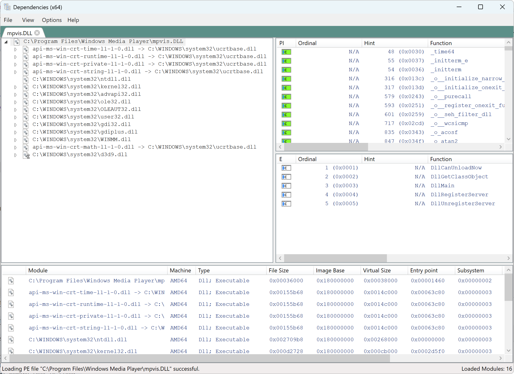

# Dependencies - modern Dependency Walker
Modern rewrite of [Dependency Walker](http://www.dependencywalker.com/).<br>
Shows dependencies of executables and DLLs, together with their imports and exports.<br>
It is a great tool for finding which DLLs are needed by a specific executable.<br>


## Limitations
* Requires Windows 10 or higher
* Only direct, forwarded, and delayed load dependencies are supported. Dynamic loading via `LoadLibrary` is not supported.
* Support of api set schema redirection since 1.5
* Checks between Api Imports and Exports.
* Minimal support for searching Sxs private manifests only.

## History of this fork
The `Dependencies` tool was originally developed by [lucasg/Dependencies](https://github.com/lucasg/Dependencies).<br>
Since development stopped, many issues and unmerged pull requests have accumulated.
This fork aims to fix bugs and keep the tool working.

## How to install
* Install [Visual C++  Redistributable](https://learn.microsoft.com/en-us/cpp/windows/latest-supported-vc-redist?view=msvc-170#latest-supported-redistributable-version)
* Download and extract the binaries from the [latest release](https://github.com/himeshsameera/Dependencies/releases)
* Use`DependenciesGui.exe` to run the GUI
* Use `Dependencies.exe` to use it from a console (run `Dependencies.exe -help` to get the usage information)

### Alternative: install via winget
You can also install this program via winget
```
winget install -e --id lucasg.Dependencies
```

## GUI dependency tree build options
* `ChildOnly` (default): only process PE child imports and nothing beyond.
* `RecursiveOnlyOnDirectImports`: do not process delay load DLLs.
* `Recursive`: Full recursive analysis. Very resource hungry.

## How to build

### Prerequisites

- Visual Studio 2026
- .NET Framework 4.8.1 and build tools
- [Git](https://git-scm.com/) 2.49 or higher (required for `git clone --revision`)

Open `Dependencies.slnx` using Visual Studio 2026, or run `./build.ps1` in PowerShell.
